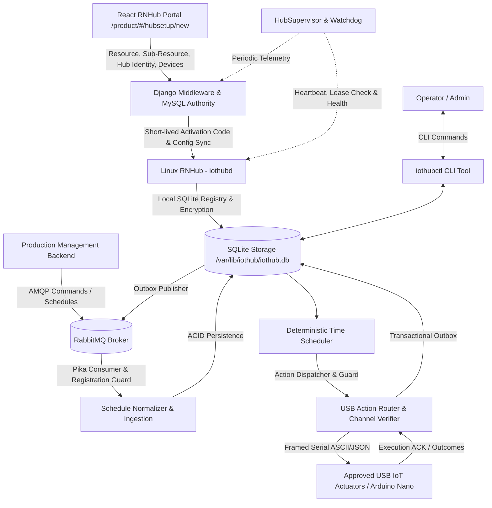

# RnR Linux IoT Hub (`iothubd`)

> **Production Management Layer | Python 3.12 · systemd · SQLite · RabbitMQ · USB Serial IoT · Arduino Nano**

The **RnR Linux IoT Hub** is an autonomous, reliable Linux system service designed to execute scheduled production workflows on localized USB IoT hardware. It connects upstream to RabbitMQ, accepts daily production schedules, guarantees idempotent and crash-resilient hardware command execution, and provides a unified terminal CLI administration tool (`iothubctl`).

---

## 1. System Architecture



### Core Architecture Highlights
* **Django Middleware Authority**: Django is the sole authority for hub identity (`hub_uuid`, `hub_id`), resource/sub-resource mapping, location, timezone, and approved physical device inventory (`connected_devices`).
* **Linux `iothubd` Execution Layer**: Remains fully responsible for local hardware execution, USB serial transport, RabbitMQ messaging, local SQLite storage, deterministic schedules, and watchdog health.
* **CLI-Only Linux Administration**: Linux installation, activation, and hardware enrollment remain terminal-only via `install.py` / `install.sh` and `iothubctl`.
* **Registration & Authorization Guards**: Runtime gatekeeper strictly enforces hub operating state (`UNREGISTERED`, `ACTIVATED`, `SUSPENDED`, `RETIRED`, `LEASE_EXPIRED`). Commands directed to unauthorized devices or unapproved physical boards are rejected before dispatch.
* **Isolated AES-256-GCM Encryption**: Sensitive credentials (machine API tokens, broker passwords) are encrypted in SQLite using a restricted master key at `/etc/iothub/keys/master.key` (mode `0600`). No plaintext secrets are retained in environment files.

---

## 2. RNHub V2 — Middleware Registration & Activation Workflow

Every Linux hub must be registered in the Django middleware before it can be activated and used in production:

```
+------------------------------------+          +--------------------------------------+
| 1. Register in React Portal        |          | 2. Issue Activation Credential       |
|    - Resource & Sub-resource       | -------> |    - Short-lived, one-time code      |
|    - Hub Name & Location           |          |    - Admin-authorized                |
|    - Proposed Connected Devices    |          |    - Hashed storage in Django        |
+------------------------------------+          +--------------------------------------+
                                                                   |
                                                                   v
+------------------------------------+          +--------------------------------------+
| 4. Authoritative Verification      |          | 3. Run Linux Installer / Activation  |
|    - Linux calls /agent/activate/  | <------- |    - Enter Middleware URL            |
|    - Django validates token & bind |          |    - Enter Hub Activation Code       |
|    - Returns canonical hub config  |          |    - Generate machine keys           |
+------------------------------------+          +--------------------------------------+
                  |
                  v
+------------------------------------+          +--------------------------------------+
| 5. Store Registration in SQLite    |          | 6. Enroll Approved USB Hardware      |
|    - hub_registration snapshot     | -------> |    - Verify against approved devices |
|    - authorized_devices table      |          |    - Bind logical device & USB MAC   |
|    - Encrypted machine API token   |          |    - Daemon starts normal operation  |
+------------------------------------+          +--------------------------------------+
```

### Step 1: Register Hub in React / Django Portal
1. Navigate to `/product/#/hubsetup/new` in the React Management Portal.
2. Select the parent **Resource** and **Sub-resource** (e.g. `Cutting Machine 1`).
3. Enter hub details: **Hub Name**, **Installation Location**, and **Timezone**.
4. Define proposed **Connected Devices** (e.g. `Lighting Controller`, `Water Valve Controller`).
5. Save the record in Django.

### Step 2: Issue One-Time Activation Credential
In Django admin / hub management, generate a short-lived, one-time activation credential (`ACTIVATION_CODE`). This credential expires quickly, can be redeemed exactly once, and is hashed in Django storage.

### Step 3: Run the Linux Installer on Target Computer
Log in to the physical Linux machine and run the installer:

```bash
git clone https://github.com/VinujaRnR/RnR_iot_hub.git
cd RnR_iot_hub

sudo bash install.sh
```

The installer launches the interactive V2 activation wizard:

```text
RN Solutions — RNHub Setup

Middleware URL:
https://api.example.com

Enter Hub Activation Code:
************

Connecting to RN Solutions middleware...
[PASS] Activation credential validated
[PASS] Registered hub found
[PASS] Hub identity verified

Hub Name    : Plants Hub 01
Hub ID      : hub-3417ebc3b479
Resource    : Cutting Machine 1
Location    : Greenhouse A - Rack 3
Timezone    : Asia/Colombo

[PASS] Configuration saved securely
[PASS] iothubd service installed
[PASS] Registration activated

Hub installation completed.
```

The operator does **not** need to manually re-enter the name, resource mapping, location, or timezone that Django has already authorized.

---

## 3. Installation Options & Headless Provisioning

### Non-Interactive / Scripted Activation
For automated deployment or provisioning scripts, pass the credentials directly:

```bash
sudo bash install.sh \
  --middleware-url "https://api.example.com" \
  --activation-code "ACT-3417EB-9921"
```

### Offline / Airgapped Installation
For test benches or isolated offline networks:

```bash
sudo bash install.sh --offline --hub-id "hub-01"
```

---

## 4. Hardware & USB Device Enrollment

All physical USB devices must match the approved device inventory provided by Django middleware.

### 1. View Middleware-Approved Devices
Check the devices authorized by Django for this hub:
```bash
sudo iothubctl devices approved
```
*Output:*
```text
Middleware-Approved Devices:
------------------------------------------------------------------------------------------------------------------------
Registration ID      Device Name                    Profile              Status               Bound MAC
------------------------------------------------------------------------------------------------------------------------
dev-001              Lighting Controller            plant_controller_v1  approved             98a316e6b658
dev-002              Water Valve Controller         plant_controller_v1  pending_binding      --
------------------------------------------------------------------------------------------------------------------------
```

### 2. Scan for Connected USB Devices
Identify physical hardware plugged into USB ports:
```bash
sudo iothubctl devices scan
```

### 3. Enroll Approved Device into SQLite Registry
Bind a detected USB hardware node to a middleware-approved registration ID:
```bash
sudo iothubctl devices enroll \
  --mac 98a316e6b658 \
  --name "Lighting Controller" \
  --port /dev/ttyUSB0 \
  --profile plant_controller_v1 \
  --registration-device-id dev-001
```
> **Security Guard**: If an operator attempts to enroll a device that is not approved in Django, `iothubctl` queries Django via `POST /api/rnhub-agent/devices/authorize/` or checks local authorized records. If unapproved, enrollment is blocked.

### 4. Auto-configure Connected Devices
Automatically detects USB serial adapters and registers approved logical device aliases:
```bash
sudo iothubctl devices autoconfigure
```

### 5. List Registered & Active Devices
```bash
sudo iothubctl devices list
```

### 6. Send Direct Hardware Commands
Send framed JSON command payloads directly to an authorized hardware device:
```bash
# Turn light ON
sudo iothubctl devices send light_glow_1 LIGHT_ON

# Turn light OFF
sudo iothubctl devices send light_glow_1 LIGHT_OFF

# Execute command with parameters
sudo iothubctl devices send light_glow_1 LIGHT_ON --params '{"intensity": 80}'
```

### 7. Remove a Device Binding
```bash
sudo iothubctl devices unbind --mac 98a316e6b658
```

---

## 5. Hub Registration Status & Configuration Synchronization

Once activated, `iothubd` periodically synchronizes state, validates operating leases, and sends telemetry heartbeats to Django.

### 1. Check Registration & Lease Status
```bash
sudo iothubctl hub registration-status
```
*Output:*
```text
================================================================================
Hub Registration Status (Django Middleware Authority)
================================================================================
Hub UUID              : 3417ebc3-b479-4b11-8f93-911b2c349abc
Hub ID                : hub-3417ebc3b479
Hub Name              : Plants Hub 01
Operating State       : ACTIVATED
Resource ID           : 12
Sub-Resource ID       : 34
Location              : Greenhouse A - Rack 3
Timezone              : Asia/Colombo
Config Version        : 4
Middleware URL        : https://api.example.com
Lease Expiration      : 2026-11-18 12:00:00 UTC (Valid)
Verified At           : 2026-11-11 11:30:00 UTC
Approved Devices      : 2 registered
================================================================================
```

### 2. Manual Configuration Synchronization
When administrative changes are made in the React portal (e.g., added devices or updated location), pull and apply the changes immediately:
```bash
sudo iothubctl hub sync
```
*Output:*
```text
Connecting to middleware at https://api.example.com...
[PASS] Hub configuration synchronized successfully (Config version 5 applied).
```

### 3. Activate Post-Installation (If installed offline)
Claim an existing Django hub registration from an already-installed hub:
```bash
sudo iothubctl hub activate --code "ACT-3417EB-9921" --middleware-url "https://api.example.com"
```

---

## 6. Device Profiles & Channel Mapping

Device profiles define permitted actuators, safety limits, and protocol formatting:

```bash
# List supported profiles
sudo iothubctl profiles list

# Inspect profile specifications
sudo iothubctl profiles show plant_controller_v1
```

**Supported Channels & Actions:**
* `relay:light`: Actions `LIGHTS_ON`, `LIGHTS_OFF`
* `relay:water_valve`: Actions `WATER_VALVE_ON`, `WATER_VALVE_OFF` (safety limit: `max_on_seconds: 90`)

---

## 7. Daily Production Schedules & Automated Execution

The hub accepts daily production schedules (e.g., [schedule.json](file:///home/rnr_hub/Documents/iot_hub/RnR_iot_hub/schedule.json)) ingested via RabbitMQ or loaded manually. The background daemon (`iothubd`) runs a 24/7 automated 60-second schedule watcher loop to track time slots and actuate hardware on state changes.

### 1. View Schedule Status & Listings
```bash
# View overall hub status and current active schedule
sudo iothubctl status

# List all stored daily schedules (ACTIVE vs SUPERSEDED)
sudo iothubctl schedules list
```

### 2. Inspect Schedule Details & Command Payloads
```bash
# Inspect all actions and timing for the active schedule
sudo iothubctl schedules show

# Inspect original raw JSON payload received from RabbitMQ
sudo iothubctl schedules show --raw

# Inspect the exact command JSON payload generated for the current time slot
sudo iothubctl schedules show --now

# Filter generated command JSON for a specific time or time range
sudo iothubctl schedules show --time 15:50
sudo iothubctl schedules show --time 15.50-15.54
```

### 3. Dispatch Scheduled Actions to Hardware
Immediately executes the scheduled action for the target time slot directly to physical hardware:
```bash
# Dispatch the action scheduled for the current time
sudo iothubctl schedules dispatch --now

# Dispatch an action for a specific time
sudo iothubctl schedules dispatch --time 16:30
```

### 4. Automated 60-Second Schedule Watcher
Continuously monitors the active schedule every 60 seconds against the local clock, detects action state changes (e.g., `OFF` -> `ON`), and transmits the command JSON payload to the hardware:
```bash
# Watch schedule live and track state changes
sudo iothubctl schedules watch

# Watch schedule for a specific target device with custom interval
sudo iothubctl schedules watch --target light_glow_1 --interval 30

# Run a single evaluation check and exit
sudo iothubctl schedules watch --once
```
> **Note:** The `iothubd` systemd service natively runs this 60s automated watcher continuously in the background.

### 5. Load and Apply Schedules
```bash
# Apply the most recently received RabbitMQ schedule to SQLite and trigger hardware
sudo iothubctl schedules apply-last
sudo iothubctl rabbitmq apply

# Load and validate a local schedule file into SQLite
sudo iothubctl schedules load schedule.json
```
> **Schedule Replacement Rule:** Whenever a new schedule is received from RabbitMQ or loaded via CLI, all previous schedule data is cleanly wiped from SQLite and replaced with the new schedule and its actions set fresh to `PENDING`. The 60-second watcher immediately evaluates the current time slot and actuates the target device accordingly.

### 6. Publish Schedule to RabbitMQ
Publishes schedule JSON to the broker exchange (`iot_commands`), automatically updating the date to today and auto-incrementing revisions:
```bash
# Publish schedule to RabbitMQ
sudo iothubctl schedules publish schedule.json

# Publish with date automatically set to today
sudo iothubctl schedules publish schedule.json --today

# Explicitly increment revision when republishing
sudo iothubctl schedules publish schedule.json --bump-revision
```

### 7. Inspect Scheduled Actions
```bash
# List scheduled actions across all daily schedules
sudo iothubctl actions list

# Filter actions by lifecycle state
sudo iothubctl actions list --status PENDING
sudo iothubctl actions list --status COMPLETED
```

### 8. RabbitMQ Broker Diagnostics
```bash
# Test connection to RabbitMQ broker and verify exchange/queue topology
sudo iothubctl rabbitmq test

# Inspect the most recent message received from RabbitMQ
sudo iothubctl rabbitmq last

# Immediately apply the last received RabbitMQ schedule to the database and hardware
sudo iothubctl rabbitmq apply
```

---

## 8. System Diagnostics & Monitoring

Run comprehensive health diagnostics on the background daemon:

```bash
sudo iothubctl doctor
```
*Output:*
```text
Checking iothubd health & environment...

 [PASS] Linux service (systemd)
 [PASS] SQLite database (/var/lib/iothub/iothub.db)
 [PASS] Master encryption key (/etc/iothub/keys/master.key)
 [PASS] RabbitMQ broker connectivity
 [PASS] USB serial interfaces & dialout permissions
 [PASS] Schedule execution engine
```

View live systemd service journal:
```bash
sudo journalctl -u iothubd.service -f
```

---

## 9. Secure Configuration & Secrets Management

Modify persistent settings and encrypted credentials entirely from the CLI without editing plaintext `.env` files:

```bash
# View all configuration settings (secrets masked)
sudo iothubctl config show

# View configuration with decrypted secrets
sudo iothubctl config show --unmask

# Update standard settings
sudo iothubctl config set hub.timezone Asia/Kolkata
sudo iothubctl config set rabbitmq.host 47.236.59.210

# Update encrypted secret (prompts securely)
sudo iothubctl config set-secret rabbitmq.password
```

---

## 10. Consistent Online Backups & Disaster Recovery

Create consistent SQLite database snapshots while the daemon is actively running:

```bash
# Create an online backup with SHA-256 integrity manifest
sudo iothubctl backup create

# List available backups
sudo iothubctl backup list

# Verify backup integrity
sudo iothubctl backup verify /var/lib/iothub/backups/backup_20261014_120000.db

# Restore from a backup
sudo iothubctl backup restore /var/lib/iothub/backups/backup_20261014_120000.db
```

---

## 11. Updating the Application

Update the hub to the latest Git release without losing database history, enrolled devices, or encrypted secrets:

```bash
# Update from main branch
sudo iothubctl update

# Update to a specific tag or branch
sudo iothubctl update --ref v1.1.0

# Or run the standalone updater script
sudo bash update.sh
```

---

## 12. Uninstallation

### Standard Uninstall (Preserves Configuration & Database)
Stops and disables `iothubd.service`, deletes `/opt/iothub` and `/usr/local/bin/iothubctl`, but **preserves** `/etc/iothub` (encryption keys) and `/var/lib/iothub` (database):

```bash
sudo bash uninstall.sh
# or
sudo iothubctl uninstall
```

### Complete Purge (Removes Everything)
Permanently deletes all application files, databases, outbox events, and master encryption keys:

```bash
sudo bash uninstall.sh --purge
# or
sudo iothubctl uninstall --purge
```

---

## 13. Command Reference Table

| Category | Command | Description |
| :--- | :--- | :--- |
| **Hub Registration** | `sudo iothubctl hub registration-status` | Display verified Django registration identity, location, and lease status |
| | `sudo iothubctl hub sync` | Synchronize configuration version and approved devices from Django middleware |
| | `sudo iothubctl hub activate --code <c> --middleware-url <u>` | Claim an existing Django registration using an activation code |
| **Status** | `sudo iothubctl status` | Overall system, queue, device, registration, and schedule status |
| **Diagnostics** | `sudo iothubctl doctor` | Comprehensive health check across all subsystems |
| **Devices** | `sudo iothubctl devices approved` | Display inventory of devices approved by Django middleware |
| | `sudo iothubctl devices scan` | Scan `/dev/ttyUSB*` and `/dev/ttyACM*` interfaces |
| | `sudo iothubctl devices autoconfigure` | Auto-detect and register serial adapters to logical aliases |
| | `sudo iothubctl devices enroll --mac <m> --name <n> --port <p> --profile <pr> [--registration-device-id <id>]` | Enroll an authorized IoT device with verified MAC identity |
| | `sudo iothubctl devices list` | Display all approved device-to-port bindings |
| | `sudo iothubctl devices send <dev> <act> [-p '...']` | Transmit direct command JSON payload to target hardware |
| | `sudo iothubctl devices unbind --mac <MAC>` | Unbind and revoke a registered device |
| **Schedules** | `sudo iothubctl schedules list` | List all daily production schedules (ACTIVE vs SUPERSEDED) |
| | `sudo iothubctl schedules show [id] [--raw]` | Inspect schedule actions or print raw JSON |
| | `sudo iothubctl schedules show --time <t> \| --now` | Filter and preview generated command JSON for target time |
| | `sudo iothubctl schedules dispatch [--now \| -t <t>]` | Dispatch scheduled action for time slot directly to hardware |
| | `sudo iothubctl schedules watch [-i 60] [--target d]` | Automated schedule watcher tracking state changes |
| | `sudo iothubctl schedules load <file> [--replace]` | Load and validate local schedule JSON into SQLite |
| | `sudo iothubctl schedules publish <file> [--today]` | Publish schedule JSON to RabbitMQ broker exchange |
| **Actions** | `sudo iothubctl actions list [--status <s>]` | Inspect scheduled actions across all daily schedules |
| **RabbitMQ** | `sudo iothubctl rabbitmq test` | Verify RabbitMQ broker connectivity and queue topology |
| | `sudo iothubctl rabbitmq last` | Inspect the last message received from RabbitMQ broker |
| **Profiles** | `sudo iothubctl profiles list` | List supported actuator profiles and channels |
| | `sudo iothubctl profiles show <ID>` | Inspect safety limits and permitted actions |
| **Config** | `sudo iothubctl config show [--unmask]` | View runtime configuration (masked or decrypted secrets) |
| | `sudo iothubctl config set <k> <v>` | Set non-sensitive runtime configuration in SQLite |
| | `sudo iothubctl config set-secret <k>` | Encrypt and store credential with AES-256-GCM |
| **Backup** | `sudo iothubctl backup create` | Create consistent online SQLite backup |
| | `sudo iothubctl backup list` | List database snapshots |
| | `sudo iothubctl backup verify <path>` | Verify SHA-256 integrity of a database snapshot |
| | `sudo iothubctl backup restore <path>` | Restore database from backup snapshot |
| **Maintenance** | `sudo iothubctl update [--ref <branch/tag>]` | Fetch latest release from GitHub and redeploy service |
| | `sudo iothubctl uninstall [--purge]` | Remove service, app files, and optionally databases |
| **Service** | `sudo systemctl status iothubd` | Check Linux systemd service state |
| | `sudo journalctl -u iothubd -f` | Stream background daemon log entries |