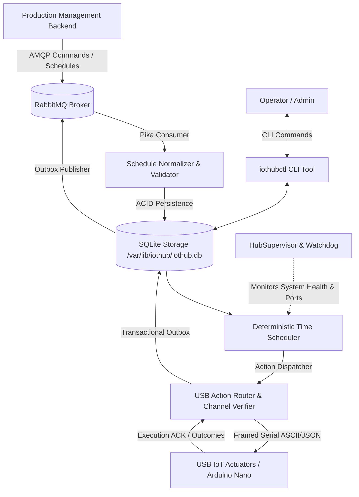

# RnR Linux IoT Hub (`iothubd`)

> **Production Management Layer | Python 3.12 · systemd · SQLite · RabbitMQ · USB Serial IoT · Arduino Nano**

The **RnR Linux IoT Hub** is an autonomous, reliable Linux system service designed to execute scheduled production workflows on localized USB IoT hardware. It connects upstream to RabbitMQ, accepts daily production schedules, guarantees idempotent and crash-resilient hardware command execution, and provides a unified terminal CLI administration tool (`iothubctl`).

---

## 1. System Architecture



### Core Architecture Highlights
* **Logical MAC vs Transient Port**: Hardware nodes are identified permanently by their unique MAC addresses (`98a316e6b658`). Linux serial device paths (`/dev/ttyUSB0`, `/dev/ttyUSB1`) are treated as dynamic connections that rebind automatically upon reconnection or reboot.
* **Device Profiles**: Channels (e.g. `relay:light`, `relay:water_valve`) are constrained by strict profiles. Commands outside permitted actions or exceeding safety limits (`max_on_seconds`) are blocked before touching hardware.
* **Crash-Resilient State Machine**: Scheduled actions transition through `PENDING -> EXECUTING -> COMPLETED / FAILED`. Rebooting or restarting the daemon never duplicates physical relay activations.
* **Isolated AES-256-GCM Encryption**: Sensitive credentials (such as RabbitMQ passwords) are encrypted in SQLite using a distinct, restricted master key at `/etc/iothub/keys/master.key` (mode `0600`).

---

## 2. Universal Installation via Git

The hub installer works across Debian/Ubuntu and systemd-compatible Linux systems. It automatically bootstraps Python dependencies, creates the isolated `iothub` service user with `dialout` hardware access, configures storage, and starts `iothubd.service`.

### Option A: Standard Git Installation (Recommended)

```bash
# 1. Clone repository
git clone https://github.com/VinujaRnR/RnR_iot_hub.git
cd RnR_iot_hub

# 2. Run universal installer (launches interactive configuration wizard)
sudo bash install.sh
```

### Option B: One-Liner Remote Installation (No Git Clone Required)

```bash
curl -fsSL https://raw.githubusercontent.com/VinujaRnR/RnR_iot_hub/main/install.sh | sudo bash
```

### Option C: Non-Interactive / Headless Installation (Docker / CI)

```bash
sudo bash install.sh --no-wizard
```

---

## 3. Post-Installation Configuration Wizard

During interactive installation, the wizard prompts you for core hub settings:

```text
------------------------------------------------------------------------
 iothubd Configuration Wizard                                           
------------------------------------------------------------------------
 [1] Hub ID [hub-01]: hub-01
 [2] RabbitMQ Host [localhost]: 47.236.59.210
 [3] RabbitMQ Port [5672]: 5672
 [4] RabbitMQ Username [guest]: rnr_iot_user
 [5] RabbitMQ Password: ****************
 [6] Schedule Timezone [Asia/Kolkata]: Asia/Kolkata
 [✓] Configuring Hub: hub-01 (Asia/Kolkata) | Broker: 47.236.59.210:5672
 [✓] RabbitMQ credentials encrypted with AES-256-GCM via master.key.
```

---

## 4. Hardware & USB Device Enrollment

After installation, use `iothubctl` to register connected USB IoT boards (e.g. Arduino Nano):

### 1. Scan for Connected USB Devices
```bash
sudo iothubctl devices scan
```
*Output:*
```text
Scanning USB serial interfaces...

  [1] /dev/ttyUSB0
      VID:PID: 1a86:7523
      Description: CH340 serial converter
      USB Serial:  1420
```

### 2. Enroll Device into SQLite Registry
```bash
sudo iothubctl devices enroll \
  --mac 98a316e6b658 \
  --name "Plant Controller A" \
  --port /dev/ttyUSB0 \
  --profile plant_controller_v1
```
*(Omit flags to run interactively with prompts).*

### 3. List Registered Devices
```bash
sudo iothubctl devices list
```

### 4. Remove a Device Binding
```bash
sudo iothubctl devices unbind --mac 98a316e6b658
```

---

## 5. Device Profiles & Channel Mapping

Device profiles define permitted actuators, safety limits, and protocol formatting:

```bash
# List supported profiles
sudo iothubctl profiles list

# Inspect profile specifications
sudo iothubctl profiles show plant_controller_v1
```

**Supported Channels & Actions:**
* `relay:light`: Actions `LIGHTS_ON`, `LIGHTS_OFF`
* `relay:water_valve`: Actions `WATER_VALVE_ON`, `WATER_VALVE_OFF` (safety limit: `max_on_seconds: 90`)

---

## 6. Daily Scheduling & Policies

The daemon accepts daily schedules (e.g., [schedule.json](file:///home/rnr_hub/Documents/iot_hub/RnR_iot_hub/schedule.json)) via RabbitMQ or manual load:

```bash
# View active schedule, pending jobs, and status
sudo iothubctl status
```

**Idempotency & Revision Rules:**
* Identical schedules delivered repeatedly are acknowledged and ignored without re-triggering physical relays.
* Higher schedule revisions (`revision: 2`) safely update future pending actions while strictly preserving already-completed actions.

---

## 7. System Diagnostics & Monitoring

Run comprehensive health diagnostics on the background daemon:

```bash
sudo iothubctl doctor
```
*Output:*
```text
Checking iothubd health & environment...

 [PASS] Linux service (systemd)
 [PASS] SQLite database (/var/lib/iothub/iothub.db)
 [PASS] Master encryption key (/etc/iothub/keys/master.key)
 [PASS] RabbitMQ broker connectivity
 [PASS] USB serial interfaces & dialout permissions
 [PASS] Schedule execution engine
```

View live systemd service journal:
```bash
sudo journalctl -u iothubd.service -f
```

---

## 8. Secure Configuration & Secrets Management

Modify persistent settings and encrypted credentials entirely from the CLI without editing plaintext `.env` files:

```bash
# View all configuration settings (secrets masked)
sudo iothubctl config show

# View configuration with decrypted secrets
sudo iothubctl config show --unmask

# Update standard settings
sudo iothubctl config set hub.timezone Asia/Kolkata
sudo iothubctl config set rabbitmq.host 47.236.59.210

# Update encrypted secret (prompts securely)
sudo iothubctl config set-secret rabbitmq.password
```

---

## 9. Consistent Online Backups & Disaster Recovery

Create consistent SQLite database snapshots while the daemon is actively running:

```bash
# Create an online backup with SHA-256 integrity manifest
sudo iothubctl backup create

# List available backups
sudo iothubctl backup list

# Verify backup integrity
sudo iothubctl backup verify /var/lib/iothub/backups/backup_20261014_120000.db

# Restore from a backup
sudo iothubctl backup restore /var/lib/iothub/backups/backup_20261014_120000.db
```

---

## 10. Updating the Application

Update the hub to the latest Git release without losing database history, enrolled devices, or encrypted secrets:

```bash
# Update from main branch
sudo iothubctl update

# Update to a specific tag or branch
sudo iothubctl update --ref v1.1.0

# Or run the standalone updater script
sudo bash update.sh
```

---

## 11. Uninstallation

### Standard Uninstall (Preserves Configuration & Database)
Stops and disables `iothubd.service`, deletes `/opt/iothub` and `/usr/local/bin/iothubctl`, but **preserves** `/etc/iothub` (encryption keys) and `/var/lib/iothub` (database):

```bash
sudo bash uninstall.sh
# or
sudo iothubctl uninstall
```

### Complete Purge (Removes Everything)
Permanently deletes all application files, databases, outbox events, and master encryption keys:

```bash
sudo bash uninstall.sh --purge
# or
sudo iothubctl uninstall --purge
```

---

## 12. Command Reference Table

| Category | Command | Description |
| :--- | :--- | :--- |
| **Status** | `sudo iothubctl status` | Overall system, queue, device, and schedule status |
| **Diagnostics** | `sudo iothubctl doctor` | Comprehensive health check across all subsystems |
| **Devices** | `sudo iothubctl devices scan` | Scan `/dev/ttyUSB*` and `/dev/ttyACM*` interfaces |
| | `sudo iothubctl devices enroll` | Register a new IoT device with MAC identity |
| | `sudo iothubctl devices list` | Display all approved device-to-port bindings |
| | `sudo iothubctl devices unbind --mac <MAC>` | Unbind and revoke a registered device |
| **Profiles** | `sudo iothubctl profiles list` | List supported actuator profiles and channels |
| | `sudo iothubctl profiles show <ID>` | Inspect safety limits and permitted actions |
| **Config** | `sudo iothubctl config show` | View runtime configuration (masked secrets) |
| | `sudo iothubctl config set <k> <v>` | Set non-sensitive runtime configuration |
| | `sudo iothubctl config set-secret <k>` | Encrypt and store credential with AES-256-GCM |
| **Backup** | `sudo iothubctl backup create` | Create consistent online SQLite backup |
| | `sudo iothubctl backup list` | List database snapshots |
| | `sudo iothubctl backup restore <path>` | Restore database from backup snapshot |
| **Maintenance** | `sudo iothubctl update` | Fetch latest release from GitHub and redeploy |
| | `sudo iothubctl uninstall [--purge]` | Remove service, app files, and optionally databases |
| **Service** | `sudo systemctl status iothubd` | Check Linux systemd service state |
| | `sudo journalctl -u iothubd -f` | Stream background daemon log entries |